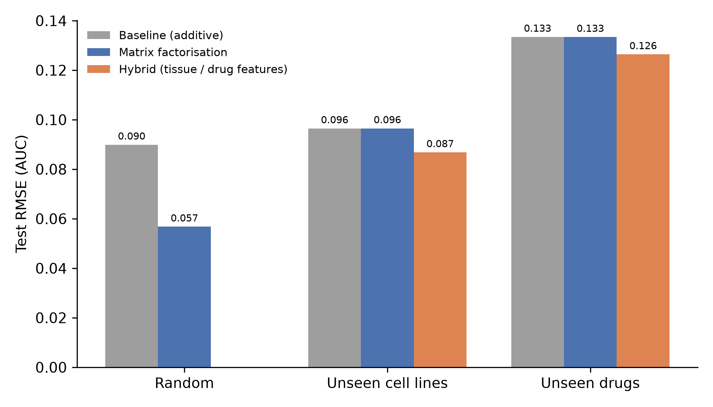
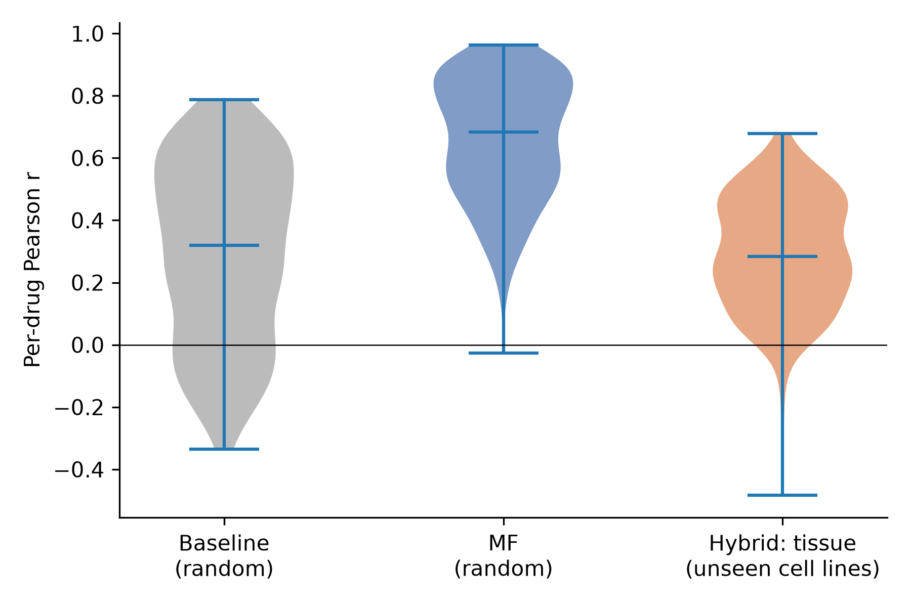
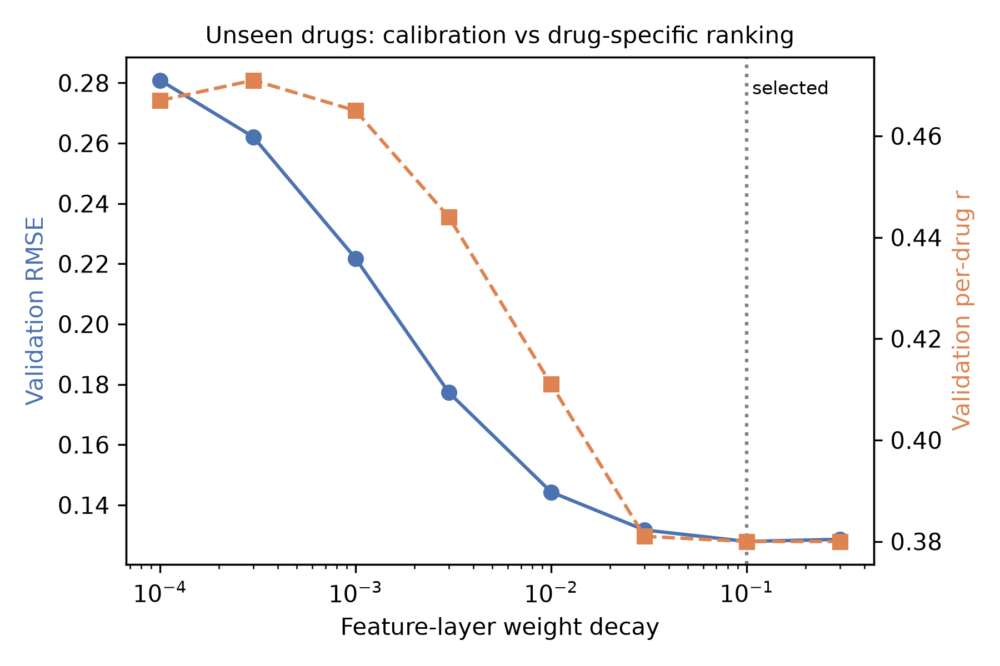

# Drug response prediction in cancer cell lines (GDSC2)

I'm a third-year Biomedical Sciences student at QMUL. I did this side project to learn machine learning properly after finishing Andrew Ng's course. It uses the GDSC2 drug screen to predict how sensitive a cancer cell line is to a drug. The screen has about 242,000 measurements across 969 cell lines and 295 drugs.

The main thing I wanted to test was what happens when the model has to predict for a cell line or a drug it has never seen before, since that's the situation that would matter in real use.

## What I did

- Started with a simple additive baseline: average response + drug effect + cell line effect.
- Built a matrix factorisation model in PyTorch, the same idea used in recommender systems. Each cell line and each drug gets a learned vector.
- Tested everything on three splits:
  - random
  - held-out cell lines
  - held-out drugs

  Settings were tuned on separate validation sets, so the test sets were only used for the final numbers.
- For the held-out cases I added features.
  - For cell lines: tissue type and driver mutations from Cell Model Passports.
  - For drugs: pathway and target genes.

I used AUC (area under the dose-response curve) as the response rather than IC50. About 72% of the IC50 values in GDSC2 are extrapolated beyond the highest concentration tested.

## Results

Test set, average of 3 runs. "r" is the correlation between predicted and real AUC across cell lines, worked out for each drug and then averaged. n/a means the model gives every new cell line the same prediction, so it can't rank them.

| Model | Random RMSE | Random r | New cell lines RMSE | New cell lines r | New drugs RMSE | New drugs r |
|---|---|---|---|---|---|---|
| Baseline | 0.0899 | 0.295 | 0.0965 | n/a | 0.1334 | 0.311 |
| Matrix factorisation | 0.0568 | 0.660 | 0.0965 | n/a | 0.1334 | 0.315 |
| + drug features | | | | | 0.1264 | 0.310 |
| + tissue | | | 0.0868 | 0.293 | | |
| + tissue and mutations | | | 0.0860 | 0.297 | | |

What I took from it:

- **Known cell lines and drugs.** Matrix factorisation works well when it has seen the cell line and drug before. RMSE drops by 37% and the per-drug correlation goes from 0.30 to 0.66.
- **New cell lines or drugs.** The same model can't do anything here. It scores exactly the same as the baseline.
- **Tissue type for new cell lines.** This brought RMSE down by about 10%, and the predictions actually differed between drugs.
  - Adding mutations didn't help on top of tissue.
  - My guess is that's because there are fewer than 800 training cell lines and the model is only linear.
- **Drug features for new drugs.** These improved RMSE a bit. When I checked, though, the model was giving every new drug the same ranking of cell lines. So it was only learning how potent a drug is overall, not which cell lines respond to it.

A couple of things caught me out along the way.

- Matrix factorisation seemed to get a correlation of 0.315 on new drugs. That turned out to be the same cell line ranking reused for every drug: predictions for different drugs correlated at 1.0.
- My first drug feature model predicted AUCs as low as -2, which is impossible. I fixed it by giving the feature layer its own, stronger regularisation.







## Files

- `Drugresp1.ipynb`: loads the GDSC2 data, adds tissue type from the Cell Model Passports model list, and makes the three train/test splits
- `Drugresp2.ipynb`: everything else, including the baseline, matrix factorisation, tuning, the drug and cell line feature models, the checks and the figures
- `data/`: the splits (`splits.npz`), the feature matrices and the validation splits. The raw data files aren't included; see below.
- `models/`: the saved trained models
- `figures/`: the three plots above
- `results.json` and `results_table.csv`: all the numbers
- `environment.yml`: the conda environment

To rerun from scratch, put these in `data/`:

- `GDSC2_fitted_dose_response_27Oct23.xlsx` from GDSC
- `model_list_20260619.csv` from Cell Model Passports

Put `mutations_summary_20260724.csv`, also from Cell Model Passports, in the main folder. Then run `Drugresp1.ipynb` followed by `Drugresp2.ipynb`.

## Running it

```
conda env create -f environment.yml
conda activate drugresp
jupyter lab
```

The raw data isn't included. You can download it from the links below.

On a Mac, install PyTorch through conda-forge rather than pip. The pip version crashed for me.

## Limitations

- Each setting was only tested on one split, so small differences, like tissue vs tissue and mutations, could just be noise.
- Everything is within GDSC2. I haven't tested it on another dataset.
- I didn't use gene expression or drug chemical structure.
- Cell lines aren't patients.

## Data

- GDSC (Wellcome Sanger Institute): https://www.cancerrxgene.org
- Cell Model Passports: https://cellmodelpassports.sanger.ac.uk (van der Meer et al., *Nucleic Acids Research*, 2019)
